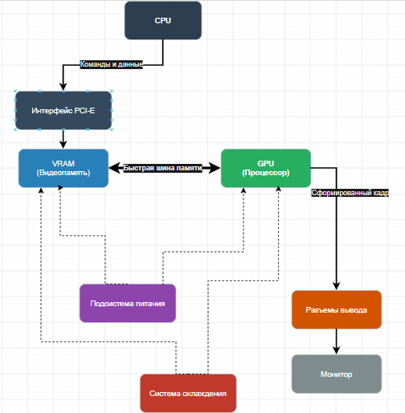

# Теория о графическом процессоре

# Часть 1. Теория

**1. Перечислите 5 основных блоков видеокарты и укажите назначение каждого.**

*   **GPU** — «мозг» карты, выполняет все математические вычисления (шейдеры, текстуры, полигоны).
*   **VRAM** — сверхбыстрая память, хранит текстуры, кадры и данные для GPU.
*   **Шина памяти** — «дорога», по которой данные летят из VRAM в GPU и обратно.
*   **Подсистема питания** — преобразует и стабилизирует напряжение для чипа и памяти.
*   **Система охлаждения** — отводит тепло, чтобы карта не перегрелась и не сгорела.

**2. Чем GPU отличается от CPU по архитектуре? Приведите 2 отличия и объясните, для каких задач выгоден каждый.**

*   *Архитектура:* У CPU мало ядер (4–16), но каждое очень мощное и умное. У GPU тысячи простых ядер.
*   *Задачи:* CPU выгоден для последовательных задач со сложной логикой (ОС, базы данных). GPU выгоден для параллельных задач (обработка пикселей, матричные вычисления).

**3. Что такое VRAM и чем она отличается от оперативной памяти компьютера? Почему видеопамять делают максимально быстрой?**

VRAM — это память на самой видеокарте. Она изолирована от системной ОЗУ. Ее делают максимально быстрой, потому что GPU нужно постоянно и очень быстро считывать гигантские объемы данных (текстуры), иначе процессор будет простаивать.

**4. Объясните своими словами, что такое SIMT (Single Instruction, Multiple Threads) и зачем GPU группирует потоки в варпы.**

SIMT — принцип, когда одна команда применяется сразу к множеству потоков данных. Варпы (группы потоков, обычно по 32 штуки) нужны, чтобы управлять тысячами потоков более эффективно: если все 32 потока в варпе делают одно и то же, они выполняют это синхронно за 1 такт.

**5. Зачем видеокарте система охлаждения и подсистема питания? Что произойдёт, если охлаждение не справится?**

При вычислениях GPU потребляет много энергии (сотни ватт), которая выделяется в виде тепла. Если охлаждение не справится, сработает **троттлинг** (сброс частот, чтобы не расплавить чип), производительность упадет, а в худшем случае видеокарта перегреется и выйдет из строя.

---

# Часть 2. Схема

### Часть 3. Практика

**7. Характеристики видеокарты:**
*   **Модель:** Intel(R) UHD Graphics (встроенная в процессор Intel Core i3-10110U).
*   **Объем VRAM:** 128 МБ .
*   **Тип памяти:** Shared (DDR4-2666).
*   **Ширина шины:** 128 бит.
*   **Число ядер (Execution Units):** 23 исполнительных блока.
*   **TDP:** ~15 Вт.

**8. Пропускная способность памяти.**

*Формула:* (Частота памяти в МГц × Ширина шины в битах) / 8.

2667 МГц × 128 бит / 8 = **42 672 МБ/с = 42,7 ГБ/с.**

**9. Шаги от запуска игры до картинки:**

1.  **CPU** читает файлы игры с диска и загружает их в оперативную память (RAM).
2.  **CPU** передает модели, текстуры и команды для рендера через шину **PCI-E** в **VRAM** видеокарты.
3.  **GPU** берет данные из **VRAM**, просчитывает физику, свет, тени и геометрию, а затем раскрашивает пиксели (растеризация).
4.  Готовый кадр записывается обратно в **VRAM**.
5.  Из **VRAM** кадр отправляется на **разъемы вывода** (HDMI/DisplayPort) и выводится на монитор.

### Часть 4. Вывод

Нейросети работают по принципу перемножения огромных массивов чисел. Чтобы обучить такую сеть, нужно пересчитать миллионы таких операций, и обычный процессор делает это очень медленно, решая задачи строго по одной. 
Видеокарта устроена иначе: в ней не 4 или 8 ядер, как в CPU, а тысячи маленьких вычислителей, которые могут работать одновременно. Поэтому GPU считает всю эту математику параллельно, выполняя сразу тысячи операций за раз, что ускоряет обучение ИИ в десятки и сотни раз. 
Именно благодаря этой способности «считать всё сразу» видеокарты стали главным инструментом для создания нейросетей.