# Управление памятью в ЭВМ

## 1. Введение

Всем компьютерам требуется место для временного хранения информации во время обработки других фрагментов информации. Обычно в цифровых компьютерах хранение информации выполняется на **двух уровнях**:

1. **Первичная память** - полупроводниковые чипы **ОЗУ** (RAM) и **ПЗУ** (ROM).
2. **Вторичная память** - устройства для хранения больших объёмов информации (обычно жёсткие диски).

Память - один из самых важных компонентов компьютерной системы. Она отвечает за хранение данных и приложений на временной или постоянной основе. Без оперативной памяти было бы невозможно разместить вычисления и процессы.

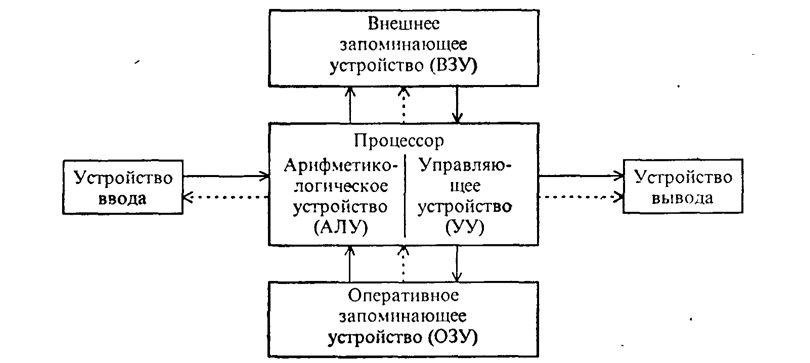

---

## 2. План (структура конспекта)

1. Иерархическая организация памяти в ЭВМ
2. Функции ОС по управлению памятью
3. Организация памяти
4. Стратегии управления памятью
5. Виды организации реальной памяти
6. Концепция виртуальной памяти

---

## 3. Память ЭВМ

Память ЭВМ состоит из **двоичных запоминающих элементов - битов**.

- В ранних ЭВМ использовались одно- и двухбайтовые ячейки.
- В современных ЭВМ используются ячейки из **4 последовательно расположенных байтов**.
- В каждую ячейку может быть записано **только одно слово** либо **одна команда**.

### Разрядность процессоров

| Процессор | Структура |
|---|---|
| 16-разрядный | Полуслова по 2 байта |
| 32-разрядный | Слова по 4 байта |
| 64-разрядный | Двойные слова по 8 байт |

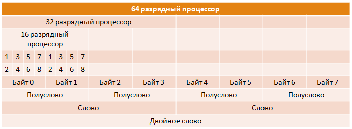

### Устройства хранения информации

1. **Электронные схемы** - реализованы в виде чипов.
2. **Накопители информации** - данные записываются на какой-либо носитель.

### Классификация памяти

**Электронные схемы:**
- ПЗУ (ROM)
- ОЗУ (RAM)

**Накопители информации:**
- Магнитные диски (гибкие, жёсткие)
- Магнитные ленты
- Оптические диски (CD, DVD)
- Магнитооптические диски

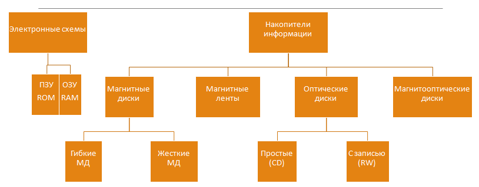

---

## 4. Виды памяти

### 4.1 Энергонезависимая и энергозависимая

| Тип | Свойство |
|---|---|
| **ПЗУ (ROM)** | Хранит информацию постоянно, энергонезависима |
| **ОЗУ (RAM)** | Хранит данные, пока подводится питание; при отключении - теряет всё |

**RAM** работает в пределах компьютерной системы, отвечает за временное хранение данных, загруженных с жёсткого диска. При выключении системы - теряет всё.

### 4.2 ROM (Read Only Memory)

- Активная память - работает независимо от того, включена система или нет.
- Постоянная, энергонезависимая.
- Данные **не могут быть изменены**.
- Это интегрированная микросхема, запрограммированная важными данными.
- Пример: **BIOS** материнской платы.

### 4.3 BIOS (Basic Input/Output System)

- Встроенное программное обеспечение, доступное без обращения к диску.
- Совокупность программ для:
  - автоматического тестирования устройств при включении;
  - загрузки ОС в оперативную память.
- Записывается заводом-изготовителем, включает:
  - программу самотестирования (POST);
  - драйверы некоторых устройств (монитор, диски);
  - программу загрузки ОС.
- Размещается на микросхеме ПЗУ (ROM) на материнской плате.

### 4.4 Другие виды памяти

- **Флэш-память** - энергонезависимый вид памяти, мобильные устройства для переноса данных.
- **CMOS** - микросхема, изготавливаемая по технологии Complementary Metal-Oxide-Semiconductor (КМОП).
- **BIOS ROM** - записывается в микросхему постоянной памяти, устанавливается на системную плату (ROM BIOS).

---

## 5. Иерархическая организация памяти в ЭВМ

Современные ЭВМ имеют **3-уровневую иерархическую организацию** запоминающих устройств (ЗУ), отличающихся средним временем доступа и стоимостью хранения данных:

| Уровень | Тип памяти | Время доступа | Стоимость | Ёмкость |
| 1 | **Кэш-память** | минимальное | максимальная | минимальная |
| 2 | **Основная память** | среднее | средняя | средняя |
| 3 | **Внешняя память** | максимальное | минимальная | максимальная |

**Закономерности:**
- Время доступа к памяти **уменьшается** снизу вверх.
- Скорость доступа **возрастает** снизу вверх.
- Стоимость на бит **растёт** снизу вверх.
- Ёмкость памяти **уменьшается** снизу вверх.

ЦП может напрямую обращаться только к кэш-памяти и основной памяти. Чтобы обратиться к внешней памяти, данные сначала нужно переписать в основную.

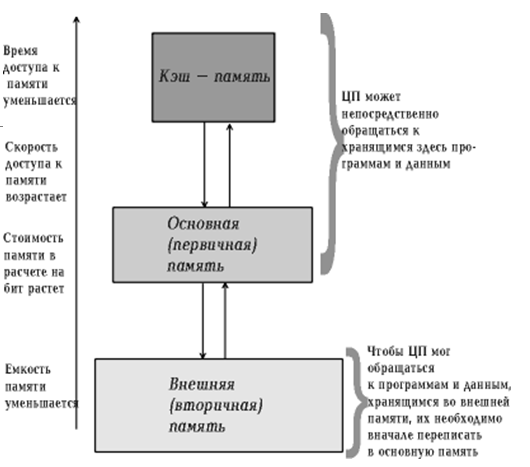

---

## 6. Кэш-память

**Кэш** (от фр. *cacher* - «прятать») - промежуточный буфер с быстрым доступом, содержащий информацию, которая может быть запрошена с наибольшей вероятностью.

- **Регистровая кэш-память** - высокоскоростная память, буфер между ОП и микропроцессором.
- Кэш хранит **копии наиболее часто используемых участков** оперативной памяти.
- Располагается **на центральном процессоре**.
- Позволяет избежать поиска информации в больших массивах ОЗУ.

### 6.1 Виды кэш-памяти по принципу записи

| Тип | Принцип работы |
|---|---|
| **С обратной записью** | Результаты фиксируются в кэш, затем в ОЗУ |
| **Со сквозной записью** | Результаты одновременно фиксируются и в кэш, и в ОЗУ |

### 6.2 Структура кэш-памяти

Кэш состоит из **набора записей**. Каждая запись:
- ассоциирована с элементом данных или блоком данных;
- имеет **идентификатор**, определяющий соответствие между данными в кэше и их копиями в основной памяти.

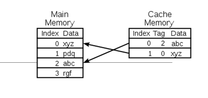

### 6.3 Кэш-попадание и кэш-промах

- **Кэш-попадание** - в кэше найдена запись с нужным идентификатором → используются данные из кэша.
- **Кэш-промах** - записи нет → данные читаются из основной памяти в кэш.

**Коэффициент попаданий (hit rate)** - процент обращений, когда результат найден в кэше.

**Пример:** браузер проверяет локальный кэш на диске для запрошенного URL. URL - идентификатор, содержимое страницы - данные. При промахе может быть принято решение отбросить запись (алгоритмы вытеснения).

### 6.4 Уровни кэш-памяти

| Уровень | Расположение | Назначение |
| **L1** | На кристалле процессора | Встроенный кэш, самый быстрый |
| **L2** | На кристалле (или на плате в старых CPU) | Второй по быстродействию |
| **Регистровая** | Внутренние регистры ЦП | 32×32 бит на 32-разрядном, 64×64 бит на 64-разрядном процессоре |

---

## 7. Оперативная память (ОЗУ / RAM)

**ОЗУ** (Random Access Memory - память с произвольным доступом):
- Все запросы ЦП, не выполненные кэш-памятью, поступают в основную память.
- Энергозависимая часть памяти: временно хранит данные и команды для процессора.

### Виды ОЗУ

- **SRAM** (статическая) - массивы триггеров.
- **DRAM** (динамическая) - массивы конденсаторов.

### Организация основной памяти

| Тип | Описание |
|---|---|
| **Стандартная (непосредственно адресуемая)** | Адреса от 0 до 1024 Кб |
| **Расширенная память** | Адреса 1024 Кб и выше, доступ через драйверы XMM |


### Обмен данными

Обмен между процессором и ОП производится через **системную шину**. К ней же подключены устройства ввода-вывода.

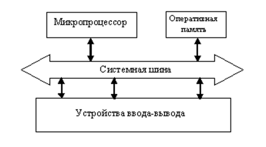

### Скорость работы (2012 год)

| Устройство | Время доступа | Скорость |
| **ОЗУ** | < 10 нс | ~10 000 Мб/с |
| **Жёсткий диск** | ~15 мс (в 1 500 000 раз медленнее) | ~150 Мб/с (в 66 раз медленнее) |

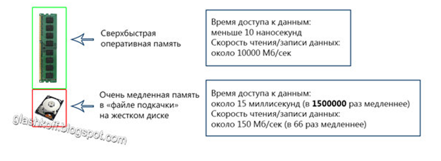

---

## 8. Внешние запоминающие устройства

### 8.1 Жёсткий магнитный диск (HDD)

- Запоминающее устройство произвольного доступа на принципе **магнитной записи**.
- Основной накопитель данных в большинстве компьютеров.
- Также называется: НЖМД, «винчестер».


### 8.2 Магнитная лента (стриммер)

- Устройство на принципе магнитной записи на **ленточном носителе**.
- **Последовательный доступ** к данным (по принципу магнитофона).
- Используется для **резервных копий** и хранения очень больших наборов данных.


### 8.3 Дополнительные устройства внешней памяти

| Устройство | Объём |
|---|---|
| FDD - накопитель на ГМД | 1,44 Мб |
| CD-ROM и R/W | 800 Мб |
| DVD-ROM и R/W | до 16 Гб |
| HDD (Hard Disk Drive) | - |
| Flash - накопитель на микросхемах | - |

---

## 9. Функции ОС по управлению памятью

Память - важнейший ресурс, требующий тщательного управления со стороны **мультипрограммной ОС**. Распределению подлежит вся оперативная память, не занятая ОС.

**Основные функции:**

1. **Отслеживание** свободной и занятой памяти.
2. **Выделение** памяти процессам и **освобождение** при завершении.
3. **Вытеснение** процессов из ОП на диск и возвращение обратно (когда размеров ОП не хватает).
4. **Настройка адресов** программы на конкретную область физической памяти.
5. **Защита памяти.**

### Защита памяти

Задача ОС - не позволить выполняемому процессу записывать или читать данные из памяти, назначенной другому процессу. Реализуется программными модулями ОС в тесном взаимодействии с аппаратными средствами.

### Организация оперативной памяти

- Физически ОП имеет **линейную организацию**: последовательность адресуемых ячеек (байт, 1 байт = 8 бит) от 0 до N.
- Делится на **слова, блоки, сегменты**.
- Номер ячейки - её **адрес**.
- Размер: Кб (1024 б), Мб (1024 Кб), Гб (1024 Мб), Тб (1024 Гб).

---

## 10. Стратегии управления памятью

ОС постоянно решает задачу: **когда, куда и за счёт кого** ввести в ОП процесс и данные.

Стратегии определяют:

- **Когда** выбирать новую программу в память: по запросам системы или с предупреждением.
- **Куда** помещать программу: плотно (занять свободные «дыры») или быстро.
- **Кого** вытеснять: дольше всех находящихся в памяти или наименее используемых.

### Три стратегии управления ОП

| Стратегия | Назначение |
| **Выборки (вталкивания)** | Когда разместить очередной блок программы/данных |
| **Размещения** | Куда помещать поступающую программу |
| **Замещения (выталкивания)** | Какой блок/сегмент вытолкнуть из ОП |

### 10.1 Стратегия выборки

**Цель:** определить момент перезаписи страницы/сегмента из внешней памяти в оперативную.

- **Выборка по запросу** - блок загружается по требованию процесса. Невозможно в общем случае определить передачу управления.
- **Упреждающая выборка** - основана на свойствах последовательного выполнения и локальности циклов. **Наиболее употребима сегодня.**

### 10.2 Стратегия размещения

**Цель:** определить место в первичной памяти для поступающей страницы/сегмента.

- **«Первый подходящий»** - эффективность по времени размещения.
- **«Наиболее подходящий»** - эффективность по объёму.
- **«Наименее подходящий»** - после размещения в больший свободный участок оставшееся место тоже велико.

### 10.3 Стратегия выталкивания

**Цель:** решить, какую страницу удалить из ОП, если она полностью занята.

- Выталкивание **случайной** страницы
- **FIFO** (First In First Out) - первая пришедшая
- **LRU** (Least Recently Used) - дольше всего не использовавшаяся
- **LFU** (Least Frequently Used) - реже всего используемая
- **NUR** (Not Used Recently) - не использовавшаяся в последнее время

### 10.4 Методы распределения памяти

**Без использования внешней памяти:**
- Однопрограммное распределение
- Мультипрограммное распределение с фиксированными разделами
- Мультипрограммное распределение с динамическими разделами

**С использованием внешней памяти:**
- Страничное распределение
- Сегментное распределение
- Сегментно-страничное распределение

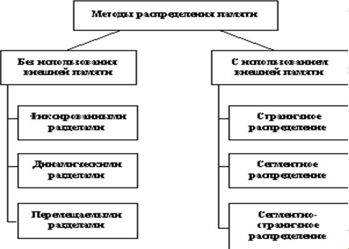

---

## 11. Виды организации реальной памяти

Выделяют **4 вида**:

1. **Однопрограммная** - выделение непрерывной области одному пользователю.
2. **Мультипрограммная с фиксированными разделами** - ОП статически делится на разделы.
3. **Мультипрограммная с динамическими разделами** - память не делится заранее, выделяется по запросу.
4. **Перемещаемые разделы** - перемещение занятых участков для борьбы с фрагментацией.

### 11.1 Однопрограммная организация

**Достоинства:** простота защиты (достаточно пары регистров, определяющих границы).

**Недостатки:** простаивает ЦП, ОП, устройства ввода/вывода. Неэффективное использование ЭВМ.

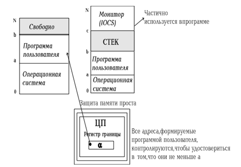

### 11.2 Мультипрограммная с фиксированными разделами

ОП при загрузке ОС статически разбивается на ряд разделов фиксированного размера. В каждом - одно задание.

**Достоинства:** большая загрузка ЦП, повышение пропускной способности.

**Недостатки:**
- **Внешняя фрагментация** - недостаточность разделов для больших программ.
- **Внутренняя фрагментация** - неиспользованная память разбита на несвязные участки.

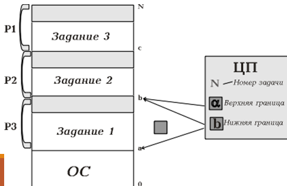

### 11.3 Мультипрограммная с динамическими разделами

- Память не делится заранее.
- Сначала вся память свободна.
- Каждой задаче выделяется необходимая память.
- Если памяти нет - задача в очереди.
- После завершения задачи память освобождается.

**Достоинства:** повышается уровень мультипрограммирования, исчезает внешняя фрагментация.

**Недостатки:** внутренняя фрагментация.

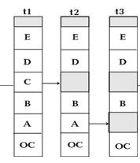

### 11.4 Перемещаемые разделы

Способ борьбы с фрагментацией - **перемещение всех занятых участков** в сторону младших или старших адресов, чтобы вся свободная память образовала единую область.

**Процедура сжатия** - копирование содержимого разделов из одного места в другое с корректировкой таблиц. Выполняется:
- при каждом завершении задачи, **или**
- когда для новой задачи нет свободного раздела достаточного размера.

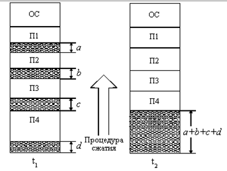

---

## 12. Понятие виртуальной памяти

### 12.1 История

Пользователи столкнулись с проблемой размещения программ, размер которых превышал свободную память.

**Решения (по порядку развития):**

1. **Оверлейная структура** - разбиение программы на части (оверлеи), которые совместно используют общую область памяти. 0-й оверлей выполнялся первым, затем вызывал следующий. Разбиение делал **программист**. Использовалось в MS DOS.

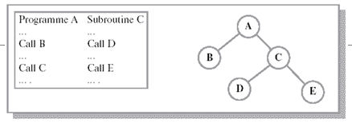

2. **Свопинг (swapping)** - образы процессов выгружаются на диск и возвращаются в ОП **целиком**. Выгруженный процесс может быть возвращён в то же или другое адресное пространство. Некоторые процессы (обычно ожидающие) временно выгружаются на диск; планировщик ОС их не исключает, при активизации - возвращает.

3. **Виртуальная память (virtual memory)** - между ОП и диском перемещаются **части** (сегменты, страницы) образов процессов.

### 12.2 Суть концепции виртуальной памяти

**Виртуальный ресурс** - ресурс, который пользователю или программе представляется обладающим свойствами, которыми в действительности не обладает.

**Виртуальная память** - основная память процесса, адресное пространство которого соответствует диапазону непосредственной адресации системы команд ЭВМ, и которая обычно **не совпадает** с объёмом реальной памяти.

**Цели:**
1. Обеспечить создание и выполнение программ **максимально допустимого размера**.
2. Облегчить жизнь программиста, сняв проблемы с ограниченным объёмом РОП.
3. Устранить **временную фрагментацию**, максимально эффективно используя ОП.

**Суть:** адресное пространство (АП) процесса **отделяется** от адресов реальной ОП и по необходимости **динамически и по частям** отображается в реальную память.

**Ключевой принцип:** программа ничего не знает о реальном размещении - она написана и выполняется так, как будто **полностью находится в РОП**.

### 12.3 Сравнение

| Своинг | Виртуальная память |
| Образы процессов выгружаются **целиком** | Перемещаются **части** (сегменты, страницы) |
| Процесс может полностью отсутствовать в ОП | Процесс всегда имеет часть в ОП |

---

## 13. Способы организации виртуальной памяти

Блоки могут быть:
- **фиксированного размера** - страницы;
- **переменного размера** - сегменты.

**Способы организации:**

1. **Динамическая страничная организация**
2. **Сегментная организация**
3. **Комбинированная сегментно-страничная организация**
4. **Двухуровневая страничная организация**

### 13.1 Задачи ОС

- Размещает данные в ЗУ разного типа (часть - в ОП, часть - на диске).
- Перемещает данные между ЗУ по мере необходимости.
- Преобразует **виртуальные адреса в физические** (ДПА).

### 13.2 Виды адресов

| Адрес | Кто присваивает |
| **Символьные** | Программист при создании программы |
| **Виртуальные** | Транслятор при переводе на машинный язык (условные, с 0-го адреса) |
| **Физические** | Соответствуют реальным номерам ячеек ОП после запуска |

---

## 14. Страничное распределение

- Виртуальное адресное пространство процесса делится на **виртуальные страницы** одинакового размера.
- Часть страниц - в ОП, часть - во ВП (файлы подкачки).
- ОП делится на **физические страницы** того же размера.
- Размер страницы - обычно степень двойки: 512, 1024 и т.д.
- **Адресное пространство двумерное**: (номер страницы, номер ячейки внутри страницы).

### 14.1 Таблица страниц

Для отображения ВАП в ФП для каждой задачи нужна **таблица страниц** (дескриптор страниц). ОС создаёт её при загрузке процесса.

**Содержимое:**
- соответствие номеров виртуальных и физических страниц;
- отметка о выгрузке страницы на диск;
- **признак модификации** страницы;
- **признак невыгружаемости**;
- **признак обращения** к странице;
- другие данные механизма виртуальной памяти.

**Алгоритм:**
1. По номеру виртуальной страницы в таблице дескрипторов находится элемент.
2. Если **бит присутствия = 1** → страница в ОП.
3. Если **бит присутствия = 0** → в дескрипторе ищется адрес виртуальной страницы (на диске).

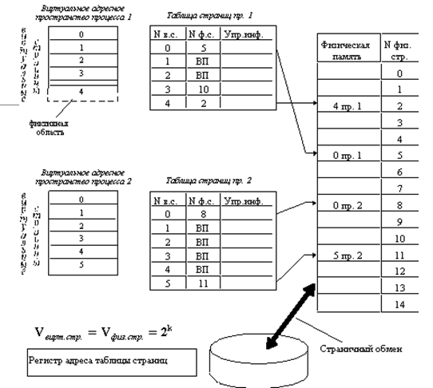
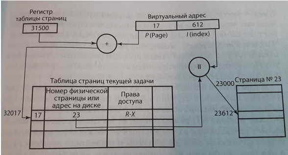

---

## 15. Сегментное распределение

- Программа разбивается на **части (сегменты)**, каждой выделяется область памяти.
- Каждый сегмент - самостоятельная единица.
- Часть сегментов - в ОП, часть - на диске.
- Сегменты одной программы могут занимать **несмежные** участки.

**Виртуальный адрес** - два поля: (номер сегмента, смещение).

**Преобразование имени сегмента** в порядковый номер - система программирования; размещение - ОС.

### 15.1 Таблица дескрипторов сегментов

Для каждого процесса ОС строит таблицу дескрипторов сегментов. В отличие от дескриптора страниц, **дескриптор сегмента имеет поле длины сегмента**.

**Пример:** сегмент № 11, смещение 612. ОС разместила сегмент, начиная с ячейки 19700 → физический адрес 20312.

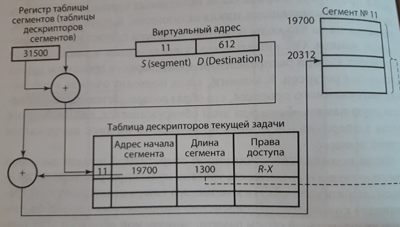

### 15.2 Особенности

- Система работает аналогично страничной: прерывания по отсутствию сегментов, выгрузка, преобразование адресов, проверка прав доступа.
- **Виртуальный адрес:** (g, s) - номер сегмента g, смещение s.
- **Физический адрес** = начальный адрес сегмента (из таблицы) + смещение s.

**Недостатки:**
- Фрагментация на уровне сегментов.
- Более медленное преобразование адреса, чем при страничной организации.

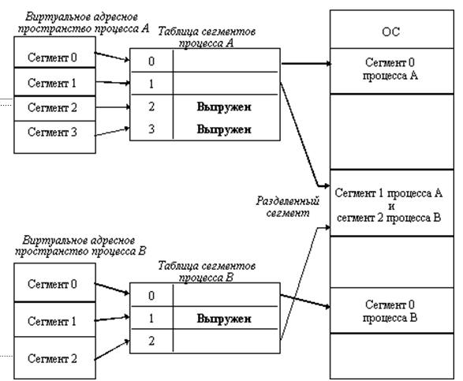

---

## 16. Схема работы виртуальной памяти по сегментно-страничной архитектуре

### 16.1 Суть сегментно-страничного распределения

**Комбинация страничного и сегментного распределения.**

- Виртуальное пространство процесса делится на **сегменты**.
- Каждый сегмент делится на **виртуальные страницы**, нумеруемые в пределах сегмента.
- ОП делится на **физические страницы**.
- Загрузка процесса - **постранично**: часть страниц в ОП, часть на диске.

**Виртуальный адрес** состоит из **трёх компонентов**:
1. **Номер сегмента** (S)
2. **Номер страницы** (P)
3. **Индекс (смещение)** (I)

Такой способ организации влечёт **задержку доступа к памяти** (двойное преобразование).

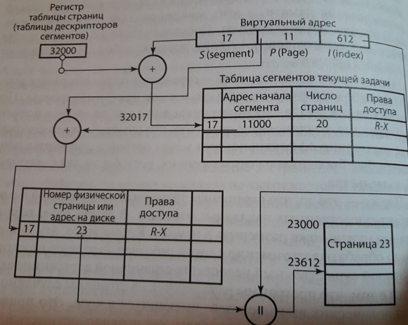

---

### 16.2 Схема преобразования виртуального адреса в физический

```
ВИРТУАЛЬНЫЙ АДРЕС
┌───────────┬───────────┬──────────────┐
│ S (сегм.) │ P (страница) │ I (смещение) │
└─────┬─────┴─────┬─────┴──────┬───────┘
      │           │            │
      ▼           │            │
┌───────────┐     │            │
│ РЕГИСТР   │     │            │
│ ТАБЛИЦЫ   │     │            │
│ СЕГМЕНТОВ │     │            │
│   32000   │     │            │
└─────┬─────┘     │            │
      │           │            │
      ▼           │            │
┌─────────────────┴──────────┐ │
│   ТАБЛИЦА СЕГМЕНТОВ        │ │
│   текущей задачи           │ │
│  ┌──────────┬───────────┐  │ │
│  │ нач.адрес│ число стр.│  │ │
│  │ 17|11000 │    20     │  │ │
│  └────┬─────┴─────┬─────┘  │ │
└───────┼───────────┼────────┘ │
        │           │          │
        ▼           ▼          │
   ┌─────────┐ ┌──────────┐    │
   │ + 32017 │►│ ТАБЛИЦА  │    │
   └─────────┘ │ СТРАНИЦ  │    │
               │ текущей  │    │
               │  задачи  │    │
               │ ┌──────┐ │    │
               │ │ 17|23│ │    │
               │ └──┬───┘ │    │
               └────┼─────┘    │
                    │          │
                    ▼          ▼
              ┌─────────────────────┐
              │  ФИЗИЧЕСКИЙ АДРЕС   │
              │     r = b + I       │
              │  23612 = 23000+612  │
              └──────────┬──────────┘
                         ▼
              ┌─────────────────────┐
              │  ФИЗИЧЕСКАЯ ПАМЯТЬ  │
              │   (Страница 23)     │
              └─────────────────────┘
```

### 16.3 Пошаговый алгоритм

| Шаг | Действие |
| **1** | Из виртуального адреса извлекаются **S, P, I**. |
| **2** | По **S** из таблицы сегментов берётся строка: адрес начала сегмента + число страниц + права доступа. |
| **3** | Вычисляется **адрес таблицы страниц** = адрес начала сегмента + смещение до нужной страницы. |
| **4** | По **P** из таблицы страниц берётся **номер физической страницы**. |
| **5** | Проверяется бит присутствия: если **1** - страница в ОП, если **0** - читается с диска. |
| **6** | Физический адрес = **база физической страницы + I**. |
| **7** | Если страница не в ОП - генерируется **прерывание** (page fault), ОС подгружает страницу с диска. |

### 16.4 Обозначения

| Обозначение | Смысл |
| **S** (segment) | Номер сегмента |
| **P** (page) | Номер страницы внутри сегмента |
| **I** (index) | Смещение внутри страницы |
| **b** | Начальный физический адрес страницы |
| **r** | Итоговый физический адрес |
| **ДПА** | Динамическое преобразование адресов |

### 16.5 Особенности

- **Двойное преобразование** → задержка доступа к памяти.
- **Разделяемые сегменты** - для организации достаточно поместить сегмент в АП каждого процесса и настроить параметры отображения. Выгружаются по тем же алгоритмам, что и индивидуальные.
- **ДПА** (динамическое преобразование адресов) поддерживается на **аппаратно-микропрограммном уровне**.

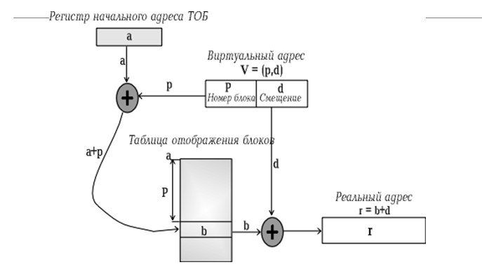

---

## 17. Разделяемые сегменты памяти

Для организации разделяемого сегмента достаточно:
1. Поместить сегмент в адресное пространство каждого процесса, которому нужен доступ.
2. Настроить параметры отображения сегментов.

Выгружаются разделяемые сегменты системой виртуальной памяти **по тем же алгоритмам**, что и индивидуальные.

---

## 18. Динамическое преобразование адресов (ДПА)

**ДПА** - механизм отображения виртуальных и реальных адресов, устанавливающий между ними соответствие.

- Компьютер выступает как **логическое устройство**, а не физическая машина с уникальными характеристиками.
- ДПА поддерживается на **аппаратно-микропрограммном уровне**.
- Механизм предполагает ведение **таблиц**, показывающих, какие ячейки ВП в текущий момент находятся в РОП и где именно.
- Отображение адресов - **на уровне блоков ОП**.

**Вопросы:**
1. Какую часть процессов держать в ОП, выталкивая одни и размещая другие?
2. Каким сделать **размер блока**? Увеличение размера → уменьшение таблицы, но увеличение времени обмена. Уменьшение → увеличение таблиц, но уменьшение времени обмена.

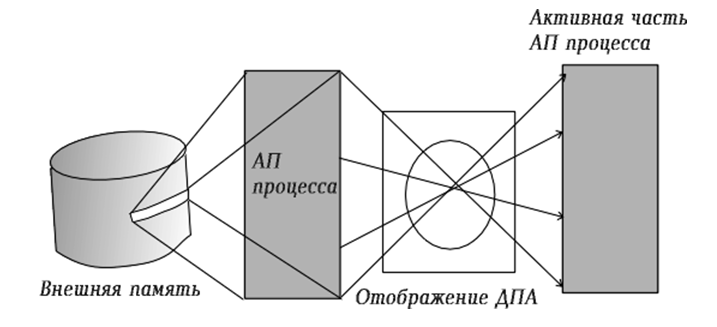

---

## 19. Выводы

1. **Виртуальная память** - это когда программа думает, что у неё много памяти, хотя на самом деле её мало. Компьютер хранит часть программы на диске, а нужные куски подгружает в оперативную память по мере необходимости.

2. Развитие управления памятью шло **постепенно**:
   - сначала программа целиком должна была помещаться в ОЗУ;
   - потом придумали **оверлеи** - разбивали программу на куски вручную;
   - затем **свопинг** - выгружали процессы целиком на диск;
   - и наконец **виртуальную память** - когда на диск выгружаются только части программы.

3. **Главная идея виртуальной памяти:** программа не знает, где именно в физической памяти лежат её данные. Она работает так, будто вся память - её. А ОС и процессор незаметно переводят виртуальные адреса в реальные.

4. **Страничная организация** - память делится на одинаковые куски (страницы). Просто и удобно.

5. **Сегментная организация** - память делится на куски разного размера (сегменты) по смыслу программы (код, данные, стек). Гибко, но сложнее.

6. **Сегментно-страничная организация** - комбинация двух предыдущих. Сначала программа делится на сегменты, потом каждый сегмент - на страницы. Самый гибкий, но самый сложный способ.

7. **Плата за удобство:** двойное преобразование адресов (сегмент → страница → физический адрес) замедляет доступ к памяти. Поэтому в реальных процессорах используют специальные кэши (TLB), чтобы ускорить перевод адресов.
