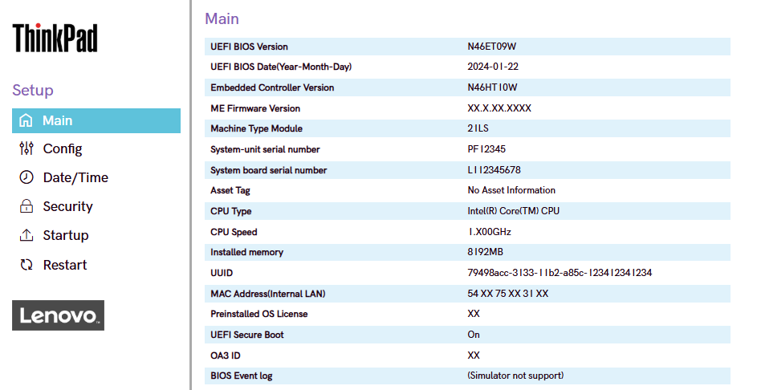
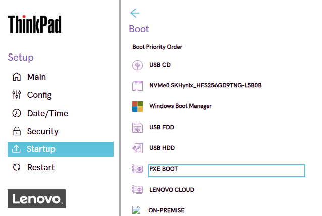
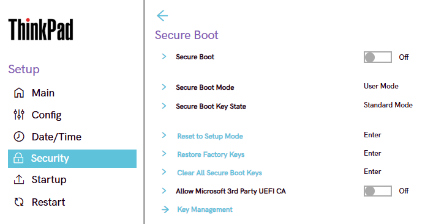
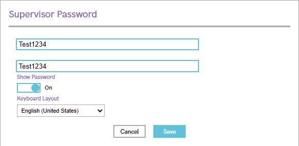
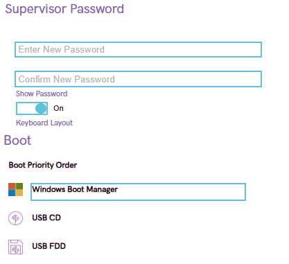
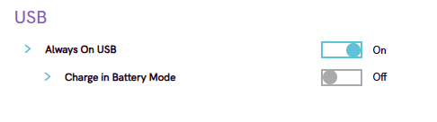

## Задача 1. Навигация по основным разделам

Были изучены разделы: **Main**, **Config**, **Security**, **Startup**, **Restart**.

В разделе **Main** отображается основная информация о системе:
*   Серийный номер устройства (Serial Number).
*   Версия UEFI BIOS.
*   Модель и тип процессора (CPU).
*   Объем установленной оперативной памяти.
*   MAC-адреса сетевых интерфейсов.

**Точный путь:** `Main`

## Задача 2. Смена порядка загрузки

Была изменена последовательность загрузки: USB-устройство установлено на первое место, встроенный накопитель NVMe — на второе. Для сохранения настроек используется клавиша **F10** (Save and Exit). После повторного входа в BIOS порядок загрузки сохранился.

**Точный путь:** `Startup` → `Boot`

## Задача 3. Включение/выключение Secure Boot

Изучен текущий статус (Enabled). При переключении на Disabled система требует перезагрузки для применения изменений. После возврата в исходное положение (Enabled) также требуется перезагрузка. 
*Назначение:* Secure Boot проверяет цифровые подписи загрузчиков ОС, предотвращая запуск вредоносного ПО.

**Точный путь:** `Security` → `Secure Boot`

## Задача 4. Установка пароля супервизора

Был установлен пароль `Test1234`. После установки при попытке изменить любую настройку (например, порядок загрузки) система запрашивает ввод пароля. Затем пароль был успешно сброшен через тот же раздел.

**Точный путь:** `Security` → `Password` → `Supervisor Password`

## Задача 5. Сброс на заводские настройки

Выполнен сброс настроек. В результате настройки из задач 2–4 были сброшены (порядок загрузки вернулся к стандартному, пароль удален, Secure Boot включен по умолчанию).

**Точный путь:** `Restart` → `Load Factory Defaults` (или клавиша **F9**)

## Задача 6. Управление встроенными устройствами

Найдена настройка **USB UEFI BIOS Support**. Она была отключена, а затем включена обратно. Эта опция отвечает за возможность загрузки с USB-устройств в среде UEFI.

**Точный путь:** `Config` → `USB` → `USB UEFI BIOS Support`

## Задача 7. Режим работы SATA/NVMe

Доступные варианты: **AHCI** и **Intel RST** (RAID). 
*Риски смены:* Переключение режима после установки ОС приведет к ошибке `INACCESSIBLE_BOOT_DEVICE` и невозможности загрузить Windows, так как в системе не будет нужного драйвера контроллера. Режим был возвращен в исходное состояние (AHCI). Не получилось открыть в силу того, что работа произодилась на эмуляторе.

**Точный путь:** `Config` → `Storage` → `SATA Controller Mode`

## Задача 8. Временное меню загрузки (эмуляция F12)

Разница между постоянным порядком и временным меню: **F12 Boot Menu** позволяет выбрать загрузочное устройство только на один раз (например, для загрузки с флешки), не меняя настройки по умолчанию. Постоянный порядок (из Задачи 2) применяется каждый раз при включении.

**Точный путь:** `Startup` → `Boot Mode`

## Задача 9. Просмотр системных логов

Найден раздел с логами событий POST. В нем отображаются ошибки и события, произошедшие при загрузке. Найдена опция **Clear Event Log** для очистки истории.

**Точный путь:** `Main` → `System Summary` (или `Config` → `Diagnostics`)

## Задача 10. Полный сценарий: подготовка к переустановке ОС

Сценарий выполнен последовательно без подсказок:
1.  **Сброс на Factory Defaults:** `Restart` → `Load Factory Defaults` (F9).
2.  **Включение Secure Boot:** `Security` → `Secure Boot` → `Enabled`.
3.  **Установка Supervisor Password:** `Security` → `Password` → `Supervisor Password`.
4.  **USB первым в Boot Order:** `Startup` → `Boot`.
5.  **Сохранение (F10):** Настройки сохранены, система перезагружена.
6.  **Проверка:** При повторном входе все настройки на месте. Пароль сброшен, порядок загрузки возвращен (NVMe первым).

## Вывод

В ходе работы были отработаны базовые и продвинутые навыки работы с UEFI: навигация, изменение порядка загрузки, работа с безопасностью (Secure Boot, пароли) и сброс настроек. Знание точных путей к настройкам (например, `Security → Secure Boot`) позволяет быстро адаптироваться к реальному железу, даже если интерфейс незначительно отличается от симулятора.