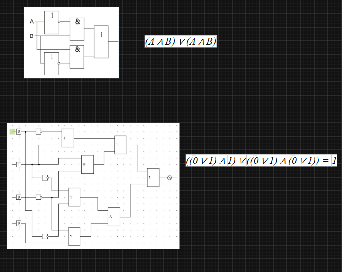
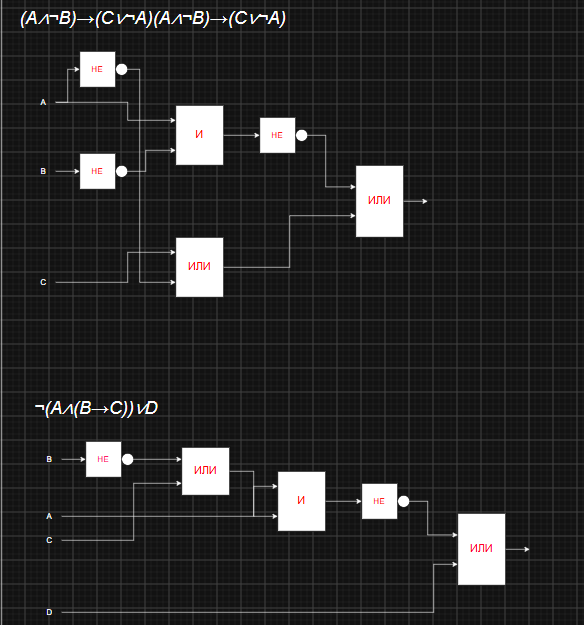

# Задание 1

# Задача: Составить логические формулы для схем, представленных на белом фоне.

# Схема 1 (верхняя):

`(A ∧ B) ∨ (¬A ∧ ¬B)` 

# Схема 2 (нижняя):

`((0 ∨ 1) ∧ 1) ∨ ((0 ∨ 1) ∧ (0 ∨ 1)) = 1`

---

# Задание 2

# Задача: Построить логические схемы на основе заданных аналитических выражений.

# Выражение 1:

`(A ∧ B) → (C ∧ ¬A) ∧ (A ∧ ¬B) → (C ∧ ¬A)`

# Выражение 2:

`¬(A ∧ (B → C)) ∨ D`

